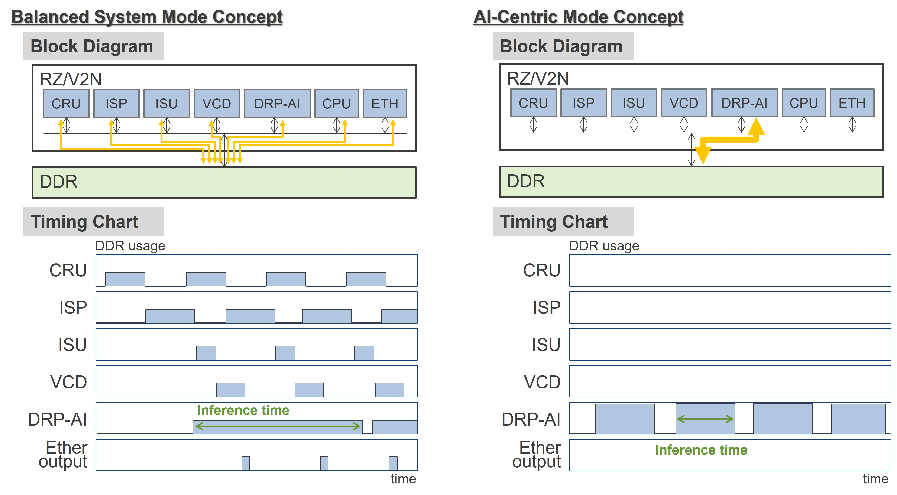

# Model list for RZ/V2N

---

## V2N measurement conditions

The V2N measurement was performed under the following two conditions:   

1. :balance_scale: **Balanced System Mode (Default)**   
**Balanced System Mode** constrains the bus bandwidth between the DRP-AI and DRAM to preserve the performance (FPS and transfer rate) of non-AI functions such as camera and codec processing. This mode is the default configuration of the [RZ/V2N AI SDK](https://renesas-rz.github.io/rzv_ai_sdk/latest/howto_build_aisdk_v2n.html).    

2. :rocket: **AI-Centric mode**   
**AI-Centric mode** allows full bus bandwidth between the DRP-AI and DRAM without limitation.    
See this [RZ/V2N AI-SDK](https://renesas-rz.github.io/rzv_ai_sdk/latest/howto_build_aisdk_v2n.html) guide for setup instructions about bus setting patch.    

## **Representative models**

| AI model | Input Shape |  :balance_scale: &nbsp;Balanced&nbsp;System Inferences/s | :balance_scale: &nbsp;Balanced&nbsp;System Inference&nbsp;time(ms) |:rocket: &nbsp;AI-Centric  Inferences/s | :rocket: &nbsp;AI-Centric Inference&nbsp;time(ms)  | Task | Params (M) |
| :-- | --: | --: | --: | --: | --: | :-- | --: |
|[YOLOv5s](./how_to_convert/How_to_convert_yolov5_onnx_models.md)|640,640|27.0|37.0|67.6|14.8|Object Detection|7.3|
|[YOLOv5m](./how_to_convert/How_to_convert_yolov5_onnx_models.md)|640,640|12.9|77.7|31.7|31.5|Object Detection|21.4|
|[YOLOv8n](./how_to_convert/How_to_convert_yolov8_onnx_models.md)|640,640|42.9|23.3|82.0|12.2|Object Detection|3.1|
|[YOLOv8s](./how_to_convert/How_to_convert_yolov8_onnx_models.md)|640,640|21.3|46.9|51.5|19.4|Object Detection|11.2|
|[YOLOv8m](./how_to_convert/How_to_convert_yolov8_onnx_models.md)|640,640|9.3|107.0|22.5|44.4|Object Detection|25.9|
|[YOLO11n](./how_to_convert/How_to_convert_yolov11_onnx_models.md)|640,640|37.5|26.7|76.3|13.1|Object Detection|2.6|
|[YOLO11s](./how_to_convert/How_to_convert_yolov11_onnx_models.md)|640,640|17.7|56.6|47.6|21.0|Object Detection|9.4|
|[YOLO11m](./how_to_convert/How_to_convert_yolov11_onnx_models.md)|640,640|4.5|223.3|23.1|43.2|Object Detection|20.1|
|[YOLO26n](./how_to_convert/How_to_convert_yolo26_o2m_onnx_models.md)|640,640|33.9|29.5|69.9|14.3|Object Detection|2.4|
|[YOLO26s](./how_to_convert/How_to_convert_yolo26_o2m_onnx_models.md)|640,640|16.1|62.0|43.9|22.8|Object Detection|9.5|
|[YOLO26m](./how_to_convert/How_to_convert_yolo26_o2m_onnx_models.md)|640,640|4.4|229.0|22.1|45.2|Object Detection|20.4|
|[YOLOX_s](./how_to_convert/How_to_convert_yolox_onnx_models.md)|640,640|24.6|40.6|58.8|17.0|Object Detection|9.0|
|[YOLOX_m](./how_to_convert/How_to_convert_yolox_onnx_models.md)|640,640|11.4|87.8|25.4|39.3|Object Detection|25.3|
|[MobileNetV2](./how_to_convert/How_to_download_ONNX_models.md)|224,224|714.3|1.4|769.2|1.3|Classification|3.5|
|[ResNet50-v1](./how_to_convert/How_to_download_ONNX_models.md)|224,224|204.1|4.9|208.3|4.8|Classification|25.6|
|[HRNet](./how_to_convert/How_to_convert_hrnet_onnx_model.md)|256,192|57.1|17.5|109.9|9.1|Pose Estimation|28.5|
|[YOLOv8n-pose](./how_to_convert/How_to_convert_yolov8pose_onnx_models.md)|640,640|42.0|23.8|81.3|12.3|Multi Person Pose Estimation|3.3|
|[YOLOv8s-pose](./how_to_convert/How_to_convert_yolov8pose_onnx_models.md)|640,640|20.7|48.3|49.8|20.1|Multi Person Pose Estimation|11.6|
|[YOLOv8m-pose](./how_to_convert/How_to_convert_yolov8pose_onnx_models.md)|640,640|9.2|109.0|22.0|45.5|Multi Person Pose Estimation|26.4|
|[YOLOv8n-seg](./how_to_convert/How_to_convert_yolov8-seg_onnx_models.md)|640,640|34.4|29.1|67.1|14.9|Instance Segmentation|3.4|
|[YOLOv8s-seg](./how_to_convert/How_to_convert_yolov8-seg_onnx_models.md)|640,640|17.5|57.1|40.2|24.9|Instance Segmentation|11.8|
|[YOLOv8m-seg](./how_to_convert/How_to_convert_yolov8-seg_onnx_models.md)|640,640|8.0|124.5|17.5|57.3|Instance Segmentation|27.3|
|[face_landmark](./how_to_convert/How_to_download_ONNX_models.md)|192,192|357.1|2.8|625.0|1.6|Face Landmark Detection|0.6|
|[hand_landmark](./how_to_convert/How_to_download_ONNX_models.md)|256,256|156.2|6.4|333.3|3.0|Face Landmark Detection|2.0|
|[MiDaS v2.1 Small](./how_to_convert/How_to_convert_MiDaS_onnx_models.md)|256,256|59.5|16.8|111.1|9.0|Depth Estimation|16.6|

---
## **List of models for each task**

:pushpin: UPDATE ARE PLANNED

----
