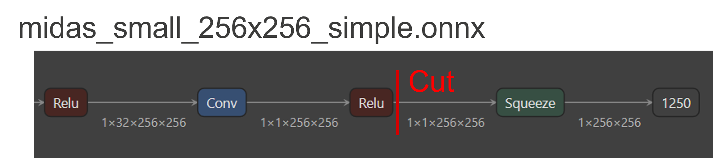

# How to convert MiDaS onnx models
<!-- Below is a list of AI models supported by this manual. -->
The AI models in the table below should be converted according to the following procedure and then entered into the compilation script.

| AI model                                                                                           | Download model name      | Input shape | Task             |
|----------------------------------------------------------------------------------------------------|--------------------------|-------------|------------------|
| [MiDaS v2.1 Small](https://github.com/isl-org/MiDaS/releases/download/v2_1/midas_v21_small_256.pt) | midas_small_256x256      | (256, 256)  | Object Detection |
---

License: [MIT License](https://github.com/isl-org/MiDaS)

## 1. Set environment variables.

1. Set up the environment, according to [Installation](../../../setup/README.md).
2. Run the following command, confirm that the REPO_ROOT path is set.

```sh
echo $REPO_ROOT
```

## 2. Create an environment for MiDaS onnx models.

```sh
apt update
apt install -y python3-venv 

python3 -m venv ${REPO_ROOT}/convert/venvs/midas
. ${REPO_ROOT}/convert/venvs/midas/bin/activate
pip install --upgrade pip 
pip install torch==2.3.1+cpu torchvision==0.18.1+cpu -f https://download.pytorch.org/whl/torch_stable.html
pip install onnx==1.16.0 onnxruntime==1.20.1
pip install timm==1.0.9 onnxsim==0.4.36
```

## 3. Convert PyTorch Model (.pth) files to ONNX (.onnx) files.

Note : Check the downloaded PyTorch Model (.pth) file from the link in the table above is located in `${REPO_ROOT}/convert`.\
Use the following script to convert the model. \
Set the options refer to the following table.

|option |value                                           |
|-------|------------------------------------------------|
|-s     |`Input shape` column in the table above         |
|-n     |`Download model name` column in the table above |
|-o     |`Download Directory` column in the table above |

---

```sh
cd ${REPO_ROOT}/convert
# The following is an example for MiDaS v2.1 Small
python download_midas_onnx.py \
    -s 1,3,256,256 \
    -n midas_small_256x256 \
    -o ${REPO_ROOT}/convert/output/midas_small_256x256_onnx

cd ${REPO_ROOT}/convert/output/midas_small_256x256_onnx
onnxsim ./midas_small_256x256.onnx ./midas_small_256x256.onnx
```

Use the following python command to remove the post-processing part.   

```py
import onnx

input_path = "./midas_small_256x256_simple.onnx"        # Set input onnx file name
output_path = input_path.replace(".onnx","_cut.onnx")   # Set output onnx file name
input_names = ['input']
output_names = ['/output_conv/output_conv.5/Relu_output_0']
onnx.utils.extract_model(input_path, output_path, input_names, output_names)
```

   

After the above command is executed, the file structure will be as follows.

```sh
${REPO_ROOT}/convert
 └── output
      └── midas_small_256x256_onnx
           └── midas_small_256x256_simple_cut.onnx
```
## 4. Delete the environment for MiDaS models.

```sh
deactivate

rm -R ${REPO_ROOT}/convert/venvs/midas
```

## 5. Next Step

To compile the model, enter the ONNX (.onnx) files into the compilation script in the tutorials.
Please refer below guides.

Basic guide
 - [Compilation tutorial](../../../tutorials/)


----
