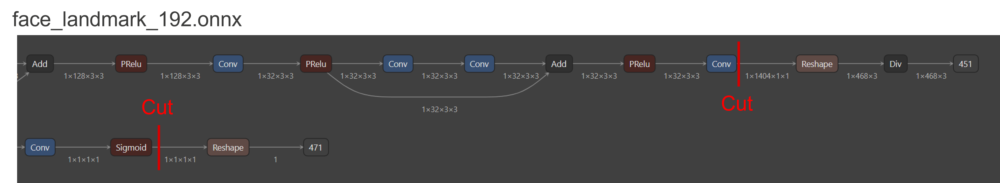
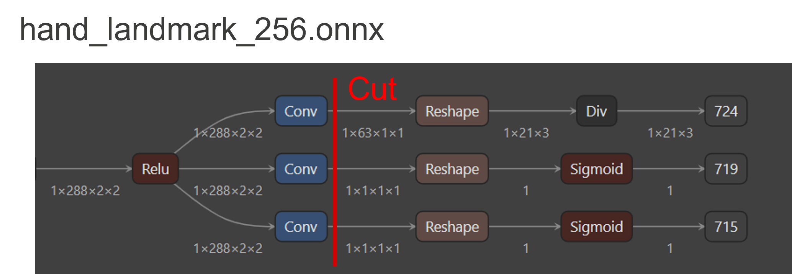

# How to convert OSS ONNX models
<!-- Below is a list of AI models supported by this manual. -->
The AI models in the table below should be converted according to the following procedure and then entered into the compilation script.

| AI model           | Download model name  | Input Shape    | Task              |
|--------------------|----------------------|----------------|-------------------|
| [YOLOv2](https://github.com/onnx/models/blob/main/validated/vision/object_detection_segmentation/yolov2-coco/model/yolov2-coco-9.onnx)        | yolov2-coco-9.onnx             | 416,416  |  Object Detection |
|[DenseNet9](https://github.com/onnx/models/blob/main/validated/vision/classification/densenet-121/model/densenet-9.onnx) |densenet-9.onnx |224,224|Classification|
|[Inception-v1](https://github.com/onnx/models/blob/main/validated/vision/classification/inception_and_googlenet/inception_v1/model/inception-v1-9.onnx) | inception-v1-9.onnx |224,224|Classification|
|[Inception-v2](https://github.com/onnx/models/blob/main/validated/vision/classification/inception_and_googlenet/inception_v2/model/inception-v2-9.onnx) | inception-v2-9.onnx |224,224|Classification|
| [MobileNetV2](https://github.com/onnx/models/blob/main/validated/vision/classification/mobilenet/model/mobilenetv2-7.onnx)           | mobilenetv2-7.onnx             | 224,224  | Classification    |
|[ResNet18-v1](https://github.com/onnx/models/blob/main/validated/vision/classification/resnet/model/resnet18-v1-7.onnx) | resnet18-v1-7.onnx |224,224|Classification|
|[ResNet34-v1](https://github.com/onnx/models/blob/main/validated/vision/classification/resnet/model/resnet34-v1-7.onnx) | resnet34-v1-7.onnx |224,224|Classification|
|[ResNet50-v1](https://github.com/onnx/models/blob/main/validated/vision/classification/resnet/model/resnet50-v1-7.onnx) | resnet50-v1-7.onnx |224,224|Classification|
|[ResNet101-v1](https://github.com/onnx/models/blob/main/validated/vision/classification/resnet/model/resnet101-v1-7.onnx) | resnet101-v1-7.onnx |224,224|Classification|
|[ResNet18-v2](https://github.com/onnx/models/blob/main/validated/vision/classification/resnet/model/resnet18-v2-7.onnx) | resnet18-v2-7.onnx |224,224|Classification|
|[ResNet34-v2](https://github.com/onnx/models/blob/main/validated/vision/classification/resnet/model/resnet34-v2-7.onnx) | resnet34-v2-7.onnx |224,224|Classification|
|[ResNet50-v2](https://github.com/onnx/models/blob/main/validated/vision/classification/resnet/model/resnet50-v2-7.onnx) | resnet50-v2-7.onnx |224,224|Classification|
|[ResNet101-v2](https://github.com/onnx/models/blob/main/validated/vision/classification/resnet/model/resnet101-v2-7.onnx) | resnet101-v2-7.onnx |224,224|Classification|
|[SqueezeNet1.1-7](https://github.com/onnx/models/blob/main/validated/vision/classification/squeezenet/model/squeezenet1.1-7.onnx) | squeezenet1.1-7.onnx |224,224|Classification|
| [face_landmark](https://github.com/renesas-rz/rzv_drp-ai_tvm/releases/download/Release-2025-12-26/face_landmark_192.onnx)           | face_landmark_192.onnx  (*1)           | 192,192  | Face landmark detection |
| [hand_landmark](https://github.com/renesas-rz/rzv_drp-ai_tvm/releases/download/Release-2025-12-26/hand_landmark_256.onnx)        | hand_landmark_256.onnx (*1)            | 256,256  | Hand landmark detection |
| [Topformer tiny](https://github.com/renesas-rz/rzv_drp-ai_tvm/releases/download/v2.4.1/topformer_tiny_512x512.onnx)        | topformer_tiny_512x512.onnx             | 512,512  |  Semantic Segmentation|

**:bulb: Note** For the Topformer model, inference time can be optimized by adding the "-f float32" option during compilation.

---

## 1. Download ONNX files.

To download the models you want to evaluate, please click the links provided in the table above.
(*1) : Before compiling, please refer to the [Appendix](#appendix) and modify the ONNX model accordingly.

## 2. Next Step

To compile the model, enter the ONNX (.onnx) files into the compilation script in the tutorials.
Please refer below guides.

Basic guide
 - [Compilation tutorial](https://github.com/renesas-rz/rzv_drp-ai_tvm/tree/main/tutorials)

Other guides
 - [How to compile model: Section 2](https://renesas-rz.github.io/rzv_drp-ai_tvm/compile_sample_model.html)
 - [How to compile your own model: Section 1, 2, 3](https://renesas-rz.github.io/rzv_drp-ai_tvm/compile_your_own_model.html)

## Appendix   

Use the following python command to remove the post-processing part.   

### face landmarker modification 
```py
import onnx

input_path = "./face_landmark_192.onnx"               # Set input onnx file name
output_path = input_path.replace(".onnx","_cut.onnx") # Set output onnx file name
input_names = ['input']
output_names = ["/Sigmoid_output_0",
                "/backbone2a/backbone2a.6/Conv_output_0"]
onnx.utils.extract_model(input_path, output_path, input_names, output_names)
```
   

### hand landmarker modification
```py
import onnx

input_path = "./hand_landmark_256.onnx"                # Set input onnx file name
output_path = input_path.replace(".onnx","_cut.onnx")  # Set output onnx file name
input_names = ['input']
output_names = ['/hand_flag/Conv_output_0',
                '/handed/Conv_output_0',
                '/landmarks/Conv_output_0']
onnx.utils.extract_model(input_path, output_path, input_names, output_names)
```
   

----