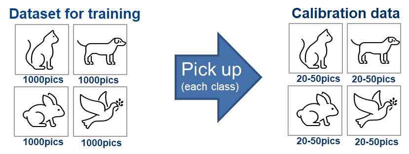
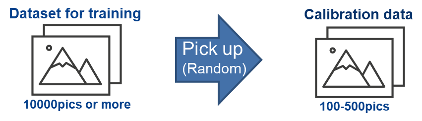

# Compile with Sample Scripts (RZ/V2H, RZ/V2N)

There are three types of sample scripts to compile an AI model.

1. Compile script with onnx model

All scripts use the DRP-AI Pre-processing Runtime Compile Module to generate object files for pre-processing, which are located in the `preprocess` directory in the output directory.
For more details on DRP-AI Pre-processing Runtime, please refer to its [Documentation](../docs/PreRuntime.md).

Additionally, if you want to know how to accelerate the AI model by pruning, you need to introduce the DRP-AI Extension Pack. The DRP-AI Extension Pack is pruning tools for accelerating the AI model. [See here for more information.](../pruning/how-to/torchvision_resnet50/README.md)

## 1. Compile onnx models

### 1.1. Example using Resnet from the official ONNX model zoo

```sh
cd $REPO_ROOT/tutorials/

# Download onnx model from official ONNX model zoo
wget https://github.com/onnx/models/raw/main/validated/vision/classification/resnet/model/resnet18-v1-7.onnx
# Fix the batch size to 1
onnxsim resnet18-v1-7.onnx resnet18-v1-7.onnx --overwrite-input-shape 1,3,224,224
python3 compile_onnx_model_quant.py \
    ./resnet18-v1-7.onnx \
    -o resnet18_onnx \
    -t $SDK \
    -d $TRANSLATOR \
    -c $QUANTIZER \
    --images $TRANSLATOR/../GettingStarted/tutorials/calibrate_sample/ \
    -s 1,3,224,224
```

----

## Tips for INT8 Quantization  
### Using the DRP-AI Quantizer
When compiling models specifically for the DRP-AI accelerator in RZ/V2H or RZ/V2N, it is mandatory to use the DRP-AI Quantizer.   
Example usage:  
```sh
-c $QUANTIZER \
-p "quantizer options"   # Adding Command Line Options for Quantization tool, e.g., -p "--calibrate_method Percentile --opts percentile_value 99.99"
```  
The DRP-AI Quantizer ensures that the model is quantized to be available on the DRP-AI. When executing the above scripts, enable the quantization tool by specifying the `-c` option. Additionally, you can pass further quantization tool options using the `-p` or `--quantization_option` flags to fine-tune the quantization parameters and settings.    

For detailed information on available options for the DRP-AI Quantizer, please refer to its [user manual](https://www.renesas.com/en/support/document-search?doc_file_all_types%5BManual+-+Software%5D=Manual+-+Software&keywords=R20UT5184EJ&page=0).  

### Calibration Data Preparation & Pre-processing Guidelines for INT8 Quantization

When using the sample script to compile the model, it includes the process of INT8 quantization. When using the sample model (specifically referring to the `resnet50-v1-7.onnx` through wget) and sample calibration data (specifically referring to the `calibrate_images_voc.tar` or `impleguide_calidata.zip` through wget), there is no need to make changes to the sample script.  
However, If using a model other than sample model or a dataset other than sample calibration data, certain modifications to the sample script are necessary to ensure the accuracy of the model after quantization. Please refer to the following content for specific adjustment methods.

#### What is calibration in quantization

Quantize calibration is crucial for the accuracy of quantized models. By preparing your calibration dataset and implementing a suitable preprocessing, you can ensure effective quantization of your AI models.

#### Prepare the Calibration data

Calibration data should originate from the same source as the training data.  
It is commonly recommended to use between 100 and 500 images for calibration data. However, the actual number should be determined based on the number of classes in your dataset. Please follow the examples below for reference when preparing your calibration data:

- If dataset has class number, pick up each class’s 20-50 representative data. For the dataset has over 100 classes, pick up fewer images as following examples.
  - For datasets with 1000 classes, prepare 1 image for each class, resulting in a total of 1000 images.
  - For datasets with 100 classes, prepare 2 to 5 images for each class, resulting in a total of 200 to 500 images.
  - For datasets with 10 classes, prepare 20 to 50 images for each class, resulting in a total of 200 to 500 images.
  - For datasets with a single class, prepare 20 to 50 images for the class, resulting in a total of 20 to 50 images.  
    
- If dataset does not have class number such as those are used for pose estimation, prepare a random selection of 100 to 500 images.  
      

For example, When using the produced `compile_onnx_model_quant.py` script, you have the flexibility to specify the amount of calibration data and specific the location of your own calibration images. The following is how to adjust the command line parameters:  

- Adjusting Calibration Data Amount  
The `-n` option in the command allows you to specify the number of images to use for calibration. For example, to use 10 images for calibration, you would include `-n 10` in your command.  
- Specifying Calibration Data Folder  
The `--images` option allows you to specify the folder containing your calibration images. This folder should contain the images you have selected for calibration based on your dataset's characteristics and class distribution.

#### Define the preprocessing of calibration data

Proper preprocessing of calibration data is essential for accurate quantization. It is crucial to ensure that the preprocessing of the calibration data is consistent with the preprocessing used to train the model, Thus it can maintaining accuracy after quantization.  
Renesas has produced a function `pre_process_imagenet_pytorch()` in sample scripts which is designed to preprocess images for the calibration of the [ResNet50](./README.md#download-pretraind-onnx-model) model.
Here's a breakdown of what the function does:

```python
def pre_process_imagenet_pytorch(img, mean=[0.485, 0.456, 0.406], stdev=[0.229, 0.224, 0.225], dims=None, need_transpose=False):
    # Color Conversion: Converts the image from BGR to RGB format
    img = cv2.cvtColor(img, cv2.COLOR_BGR2RGB)
    # Image Conversion: Converts the OpenCV image to a PIL Image.
    img = Image.fromarray(img)
    # Resizes the image to 256x256 pixels using bilinear interpolation.
    img = F.resize(img, 256, Image.BILINEAR)
    # Center Cropping: Crops the center 224x224 pixels from the resized image.
    img = F.center_crop(img, 224)
    # Conversion to Tensor: Converts the PIL Image to a PyTorch tensor.
    img = F.to_tensor(img)
    # Normalization: Normalizes the image tensor using the provided mean and standard deviation values.
    std = stdev
    img = F.normalize(img, mean, std, inplace=False)
    # Transpose: Optionally transposes the image tensor from CHW to HWC format (NHWC after batch dimension is added).
    if not need_transpose:
        img = img.permute(1, 2, 0) # NHWC
    #Array Conversion: Converts the tensor to a NumPy array of type 'float32'.
    img = np.asarray(img, dtype='float32')
    return img
```

#### Customizing the data preprocessing

To use other models or other calibration data to perform quantization, modify this function which should be consistance with the preprocessing during training model.

#### Customizing the Normalization paramter  

To adapt this preprocessing function to your specific model, Another thing need to be aware is the normalization parameter - the mean value and the standard deviation. These values must be consistent with the model when it was trained.

- Modifying Mean Value and Standard Deviation  
  - Mean Value (mean): This is a list of three values corresponding to the mean of the RGB channels. Update these values to match those used in your model's training.
  - Standard Deviation (stdev): This is a list of three values corresponding to the standard deviation of the RGB channels. Update these values to match those used in your model's training.  
For example, if your model was trained with different mean and standard deviation values, Please edit the following `LINE 143` and `LINE 144` in the `compile_onnx_model_quant.py`:  

    ```python
    mean    = [0.485, 0.456, 0.406]
    stdev   = [0.229, 0.224, 0.225]
    ```

### Notes Regarding Quantization Advanced options `--opts` Flag

The DRP‑AI Quantizer has advanced options via the `--opts` flag.  

Example of Correct Usage: <span style="color:green;">✅ OK</span>  
```bash
-p "--opts activation_zeropoint True percentile_value 99.99"
```


When passing advanced options through `--quantization_option` or `-p`, keep the following in mind:  

* **Single `--opts` Limitation**  
The `--opts` flag should only appear once when pass parameter to argument `--quantization_option` or `-p`. Due to limitations in the Python command-line parser, multiple occurrences of `--opts` will cause unexpected behavior, where only the last `--opts` is processed.

Example of Incorrect Usage: <span style="color:red;">❌ NG</span>  
```bash
-p "--opts activation_zeropoint True --opts percentile_value 99.99"
```  

```bash
work_dir=$PWD
cd ${TOOL_DIR}
python3 -m drpai_quantizer.cli_interface --calibrate_method MinMax \
        --input_model_path ${work_dir}/${MODEL_DIR}/${INPUT} \
        --output_model_path ${work_dir}/${OUTPUT} --tvm \
        ${QUANT_OPTION} \
        --opts exclude_act_func_dir ${work_dir}/exclude_operator
```  
Due to the hardcoded option `exclude_act_func_dir`, any additional advanced options provided via `--quantization_option` or `-p` with `--opts` flags will be ignored or overwritten.

#### Workaround:  
As a workaround, remove the hardcoded options(The `L67` in `run_quantization_onnx.sh`) from the shell script and instead consolidate all advanced quantization options through a single instance of the `--opts` flag, specified via `--quantization_option`  or `-p`.


----

## Appendix

### a. SPARSE_ENABLE option

SPARSE_ENABLE is sparse option.  
This option is enabled by default.  
If you want to explicitly disable Sparse mode (to ensure processing in Dense mode), specify this option to false.  
Please set `SPARSE_ENABLE=false`  as below.  

``` bash
SPARSE_ENABLE=false python3 compile_onnx_model_quant.py ./resnet50-v1-7.onnx -o resnet50_v1_onnx -t $SDK -d $TRANSLATOR -c $QUANTIZER --images calibrate_images_voc 
```

----
